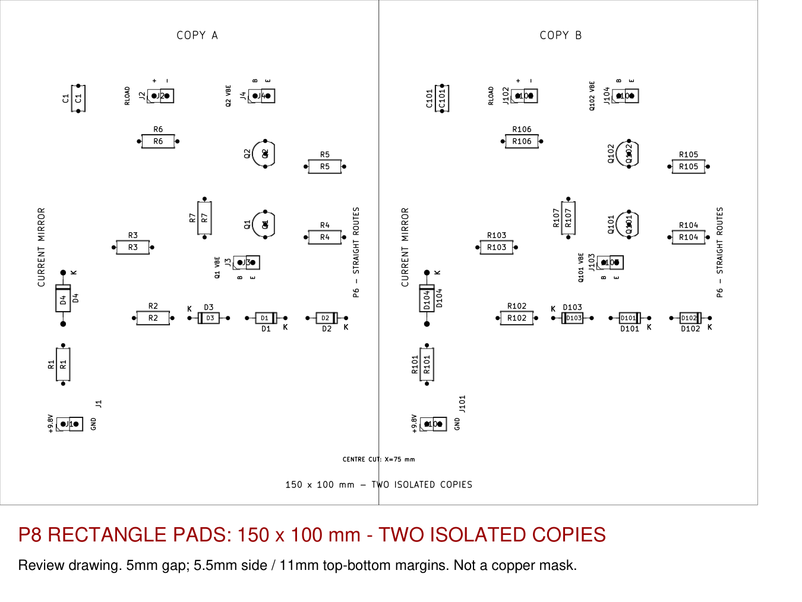

# PCB Design and Manufacturing Guide

This directory contains the KiCad implementation of the diode-compensated current mirror: a reusable circuit and a 150 x 100 mm panel containing two isolated copies. See the [project overview](../README.md) for component values and measurement instructions.

## Projects and previews

| Project | Purpose | Board size |
|---|---|---|
| [dual_current_mirror.kicad_pro](dual_current_mirror.kicad_pro) | Complete panel for fabrication | 150 x 100 mm |
| [current_mirror.kicad_pro](current_mirror.kicad_pro) | Reusable single circuit | 78 x 67 mm |

Open with **KiCad 10.0.7 or later**. Open the PCB in PCB Editor and press **Alt+3** for 3D. Both projects use [Project.pretty](Project.pretty/) through the supplied `fp-lib-table`. Reopen files from disk after external edits to avoid saving an older editor copy over them.

[Assembly PDF](previews/dual_panel_assembly.pdf) | [Copper review](previews/dual_panel_copper_review.png) | [Schematic PDF](previews/dual_panel_schematic.pdf)

The supplied screenshot shows the current placement and routing before the rectangular-pad update. The generated previews show the current pad outlines.

## Board construction

| Parameter | Specification |
|---|---|
| Physical copper / thickness | Single-sided B.Cu / 1.7 mm |
| Tracks | 0.6 mm; horizontal, vertical and 45 degrees sections |
| Configured minimum different-net clearance | 0.8 mm |
| Vias / jumpers / pours | None |
| Footprints / nets | 36 / 24 |
| Pad shapes | 36 rectangular, 40 circular |
| Holes | 56 x 0.8 mm; 16 x 1.0 mm; 4 x 1.1 mm |

Each unit is rotated 90 degrees, occupying 67 x 78 mm. Copy A's unit rectangle spans x=5.5-72.5 mm, y=11-89 mm; copy B spans x=77.5-144.5 mm, y=11-89 mm. The unit rectangles have a 5 mm gap.

Copy B adds 100 to the references: Q1 -> Q101, J1 -> J101, etc. All A/B nets are separate, including ground. Shared external supplies or instruments can connect them externally.

Only the outer boundary is on Edge.Cuts. The centre separation line is on User.1 and exports separately. Through-hole pads appear on both copper layers in KiCad's data model; all routing and fabrication copper artwork are B.Cu.

## Headers and footprints

All eight connectors are 1x2 male headers, 2.54 mm pitch. Use female jumper leads for power and instruments.

| Function | Copy A / B | Pin 1 | Pin 2 |
|---|---|---|---|
| 9.8 V power | J1 / J101 | VIN | GND |
| Load voltage | J2 / J102 | VCC | OUT |
| First transistor VBE | J3 / J103 | BASE | E1 |
| Second transistor VBE | J4 / J104 | BASE | E2 |

Use DC volts with red on pin 1 and black on pin 2. Emitters are separate nodes above their 22 ohm resistors. Do not fit shorting caps.

In the single-unit orientation, transistor pads are 1.7 x 2.4 mm with 0.8 mm holes; header pads are 2.4 x 1.7 mm with 1.0 mm holes. Both have 2.54 mm pitch and a 0.84 mm adjacent-pad gap. Panel rotation swaps the X/Y dimensions.

All transistor and header pads are rectangular. Identify pins by numbering and assembly labels, not pad shape. Transistor numbering is **1=E, 2=B, 3=C**; check the actual manufacturer's pinout. Confirm lead forming, resistor pitch of 7.62 mm and C1's assumed 5 mm lead spacing before fabrication.

[Panel BOM](panel_BOM.csv) | [Panel component/net data](panel_components.json) | [Unit BOM](BOM.csv)

## Machine handoff

Use [dual_panel_machine_files.zip](fabrication/dual_panel_machine_files.zip). The separately named [dual_panel_coppercam_rectangles.zip](fabrication/dual_panel_coppercam_rectangles.zip) contains identical files for the fresh import check.

| File | Import as |
|---|---|
| `dual_current_mirror-B_Cu.gbr` | Copper to retain |
| `dual_current_mirror.drl` | Excellon drilling data |
| `dual_current_mirror-Edge_Cuts.gbr` | Optional outer outline |
| `dual_current_mirror-Centre_Cut.gbr` | Optional centreline separation cut |

All files use millimetres, absolute coordinates and a shared unmirrored origin. Apply machine-side positioning or mirroring consistently to copper, drilling and cutting. No front-copper file is required. These files are CAM inputs; the operator generates executable machine output.

For CopperCAM:

1. Extract into a fresh folder and start a new circuit with the copper Gerber.
2. Before calculating contours, verify all three pads on each of Q1, Q2, Q101 and Q102, plus the header and diode pads.
3. Import the drill file and check every hole against its pad centre. The lab previously resolved registration using layers 1 and 5.
4. Inspect the calculated isolation paths for intact pads and connections before machining.

The export contains only standard circle/rectangle pad apertures, without oval pads, rounded rectangles, aperture macros or filled pad regions. **The rectangular-pad version still requires import confirmation in the lab's CopperCAM installation.**

### Centre separation

The centre-cut file contains one straight line at x=75 mm, y=0-100 mm in board coordinates. Import it as a separate centreline cutting operation, preserving alignment with the copper. It is not a closed outline or copper artwork.

[centre_cut_setup.json](centre_cut_setup.json) records the SRM-20, 1.7 mm board, 0.8 mm cutter diameter and maximum 0.4 mm pass depth. Nominal planning depths to board bottom are 0.4, 0.8, 1.2, 1.6 and 1.7 mm.

No executable RML/G-code or tabs are included. The operator must confirm feeds, spindle speed, safe Z, Z-zero, cutter type/usable length, holding, breakthrough allowance and output format. Secure both halves over a suitable sacrificial board and complete isolation and drilling before separation. A centred 0.8 mm kerf leaves nominal 74.6 x 100 mm halves without outer trimming.

### Printed masks

[Unmirrored 1:1 PDF](fabrication/dual_panel_BCu_unmirrored_1to1.pdf) | [Mirrored 1:1 PDF](fabrication/dual_panel_BCu_mirrored_1to1.pdf)

These contain B.Cu only; black denotes copper to keep. Confirm transfer orientation and exposure polarity with the lab. Print at Actual Size / 100%, measure the 50 mm calibration line and transfer only the board area. Review drawings are not masks. See [printing instructions](fabrication/PRINTING_README.md).

## Verification records

Recorded native checks report zero ERC/DRC violations, zero unconnected items and zero schematic-parity issues under the configured rules. Independent audits cover component values, netlist-to-pad agreement, header roles, unique identifiers, isolation, clearances and all 76 pad/drill locations.

| Record | Scope |
|---|---|
| [Panel audit](reports/panel_audit.json) | Dimensions, isolated nets and component mapping |
| [Panel ERC](reports/panel_erc.json) / [DRC](reports/panel_drc.json) | Native KiCad checks |
| [Source connectivity](reports/source_connectivity.json) | LTspice topology comparison |
| [Solder clearance](reports/solder_clearance.json) | Pad gaps and annular copper |
| [Pad audit](reports/coppercam_pads.json) | Rectangular transistor pads and Gerber apertures |
| [Export verification](fabrication/machine_files/verification.json) | Copper/drill geometry and cutting files |
| [Panel hashes](reports/panel_sha256.json) | Design and print-artifact integrity |

The reports establish saved-file consistency, not machining or electrical performance. Original LTspice files are preserved. The PCB uses fixed nominal 120 ohm resistors; the original source used RV=117.6 ohm. Earlier revision reports and trimmer templates are historical records.

## Maintenance

The [scripts](scripts/) include generators, routing, exports and checks. KiCad's bundled Python supplies `pcbnew`; PNG preview rendering uses regular Python with PyMuPDF. Some source checks also read installed LTspice symbols.

Treat the saved CAD files as the handoff design. Back up manual edits before running generators or the router: they rebuild geometry and may replace the saved placement or routing. After CAD changes, regenerate the relevant netlists, ERC/DRC/parity reports, audits, previews and manufacturing exports before packaging a new ZIP.

`export_machine_files.ps1` exports machine files; `check_machine_files.py` compares them with the board and writes verification/checksum records. Package those checked files together. Documentation-only edits do not require regeneration of manufacturing artifacts.
